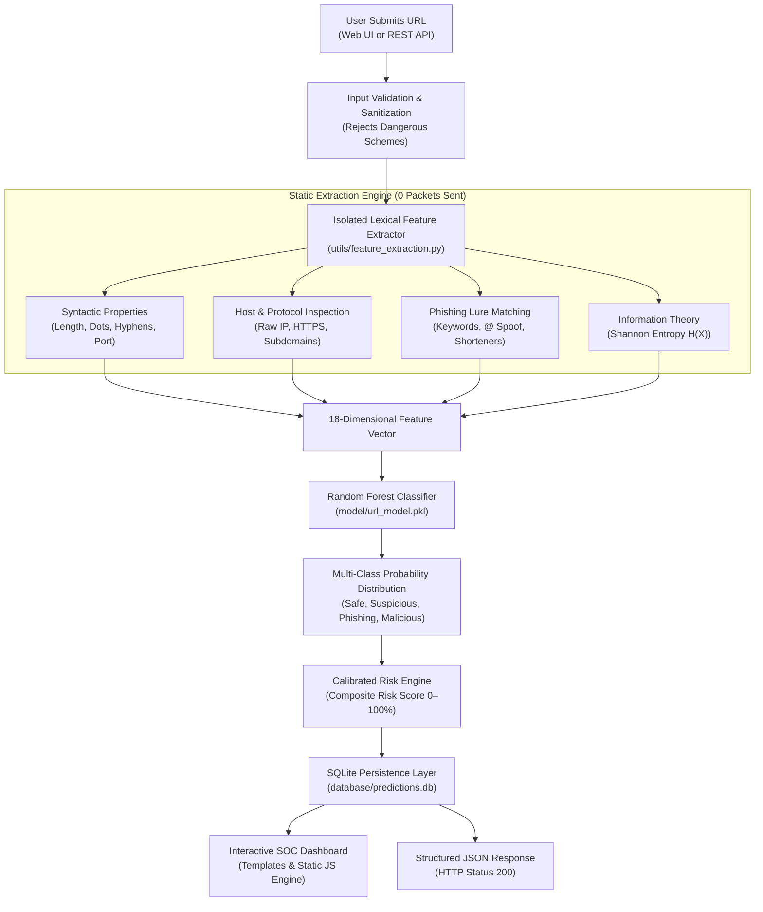

# 🛡️ Malicious URL Detection System (Cybersecurity Lab)

[](https://www.python.org/)
[](https://flask.palletsprojects.com/)
[](https://scikit-learn.org/)
[](https://www.sqlite.org/)
[](LICENSE)
[](#-zero-network-static-security-guarantee)

An AI-powered cybersecurity Security Operations Center (SOC) dashboard and automated threat analysis engine that inspects uniform resource locators (URLs) to classify threats into **Safe**, **Suspicious**, **Phishing**, or **Malicious** categories using **isolated static lexical extraction**, **Shannon entropy profiling**, and **Random Forest Machine Learning**.

---

## 📌 Executive Summary

Modern cyberattacks—including credential phishing, business email compromise (BEC), and drive-by malware drops—frequently leverage deceptive URLs engineered to bypass conventional domain reputation filters. 

This project delivers a **production-ready cybersecurity platform** capable of evaluating arbitrary URL strings in real time. Crucially, the inspection engine operates **under strict static isolation**: it parses URL strings, analyzes syntax, calculates Shannon entropy, and applies supervised machine learning **WITHOUT establishing outbound network connections, executing remote code, or transmitting packets to the target server**.

---

## ✨ Key Features & Capabilities

- **🛡️ Zero-Network Static Security**: Operates strictly air-gapped against target URLs. Eliminates server-side request forgery (SSRF), token execution, or alerting attackers through DNS probes.
- **⚡ Multi-Class Machine Learning**: Random Forest ensemble classifier trained to distinguish four discrete threat classes:
  1. `Safe`: Authoritative, legitimate, and standard structure.
  2. `Suspicious`: Masked redirects, excessive subdomains, or obfuscated tokens.
  3. `Phishing`: Brand typosquatting, credential harvesting keywords, and deceitful hostnames.
  4. `Malicious`: Direct executable drops, raw IP hostnames, and anomalous entropy patterns.
- **📊 Calibrated 0–100% Risk Score**: Dynamic threat rating with actionable risk tiers (`Low Risk`, `Moderate Risk`, `High Risk`, `Critical Threat`).
- **🧬 Comprehensive 18-Feature Lexical Extraction**:
  - Length attributes: URL length, domain length, path length, query parameter length.
  - Structural characters: Dot count, hyphen count, consecutive hyphens (`--`), numeric digits, special characters.
  - Protocol & Host indicators: HTTPS encryption check, raw IPv4/IPv6 hostname detection, non-standard port checks (`:8080`).
  - Obfuscation & Social Engineering: Subdomain depth, known URL shortener detection (`bit.ly`, `tinyurl`), `@` symbol credential spoofing, open redirect indicators, sensitive phishing keywords (`login`, `verify`, `banking`, `secure`).
  - Information Entropy: Shannon entropy $H(X)$ calculation to detect Domain Generation Algorithms (DGA) and randomized payload paths.
- **🖥️ SOC-Grade Glassmorphic Dashboard**:
  - High-tech dark cyber aesthetic built with modern CSS tokens, glowing accents, and radar animations.
  - Interactive **Chart.js** threat distribution doughnut visual.
  - Real-time KPI summary cards based on stored scan logs.
  - Circular SVG risk gauge with counter animations.
  - One-click benchmark sample buttons for instant presentation and testing.
- **🗄️ Persistent SQLite Audit Trail**: Historical scans, extracted feature dictionaries, probability vectors, and timestamps are saved in SQLite (`database/predictions.db`).
- **🧪 Automated Unit & Integration Test Suite**: 17 automated tests covering lexical extraction, heuristics, API validation, and security constraints.

---

## 📸 Dashboard Preview

```text
+---------------------------------------------------------------------------------------------------+
|  [🛡️] MALICIOUS URL DETECTION SYSTEM             ⚡ Scanner   📈 Metrics   📊 Analytics   🕒 History |
+---------------------------------------------------------------------------------------------------+
|  CYBERSECURITY THREAT INTELLIGENCE PLATFORM                                                        |
|  Static Lexical & Machine Learning Malicious URL Detection                                        |
|  [Zero Outbound Traffic]   [Random Forest]   [18 Structural Vectors]   [SQLite Audit Trail]        |
+---------------------------------------------------------------------------------------------------+
|  TOTAL ANALYZED: 42      SAFE DOMAINS: 24       SUSPICIOUS URLS: 8       THREATS IDENTIFIED: 10   |
+---------------------------------------------------------------------------------------------------+
|  TARGET >> [ https://example.com/login                           ]  [ ⚡ Analyze URL ]            |
|  Presets: [Safe: GitHub] [Phishing: Fake PayPal] [Malicious: Raw IP Binary] [Suspicious: Shortener]|
+---------------------------------------------------------------------------------------------------+
|  [ SCAN_VERDICT ]                                                                                 |
|  VERDICT: PHISHING (High Risk)  •  RISK SCORE: 94.5%  •  CONFIDENCE: 98.2%                        |
|  Probabilities: Safe: 1.2% | Suspicious: 3.1% | Phishing: 91.8% | Malicious: 3.9%                 |
|  Red Flags: Hyphenated brand name • 3 Phishing keywords • Unencrypted cleartext HTTP              |
+---------------------------------------------------------------------------------------------------+
```

*(Place actual PNG/WebP screenshots inside the [`screenshots/`](screenshots/) directory to showcase the dashboard in your repository).*

---

## 🏗️ Architecture & Dataflow



---

## 📂 Project Directory Structure

```text
malicious-url-detection/
├── app.py                      # Flask REST API server, security headers & routing
├── requirements.txt            # Production dependencies
├── .env.example                # Environment variable template
├── .gitignore                  # Git exclusion rules (bytecode, venv, secrets)
├── LICENSE                     # MIT Open Source License
├── README.md                   # Complete system documentation
│
├── model/
│   ├── train_model.py          # Random Forest training pipeline & dataset
│   └── url_model.pkl           # Pre-trained ML model binary & metadata
│
├── utils/
│   └── feature_extraction.py   # Safe lexical feature extraction engine (18 vectors)
│
├── database/
│   ├── db_handler.py           # SQLite connection, CRUD queries & metrics
│   └── predictions.db          # Persistent SQLite audit database
│
├── templates/
│   └── index.html              # Modern Cyber SOC dashboard (HTML5 / Semantic)
│
├── static/
│   ├── style.css               # Glassmorphic dark cyber theme styling
│   └── script.js               # Client REST caller, Chart.js logic & DOM engine
│
├── tests/
│   ├── __init__.py             # Test package initializer
│   ├── test_features.py        # Unit tests for feature extraction & entropy
│   └── test_api.py             # Integration tests for Flask endpoints & validation
│
└── screenshots/                # Application UI screenshots for GitHub portfolio
```

---

## ⚙️ Prerequisites

- **Python 3.10, 3.11, or 3.12**
- Modern Web Browser (Chrome, Firefox, Edge, Safari, Brave)
- Optional: Git for version control

---

## 🚀 Installation & Setup

### 1. Clone the Repository
```bash
git clone https://github.com/your-username/malicious-url-detection.git
cd malicious-url-detection
```

### 2. Configure Virtual Environment

**Windows (PowerShell):**
```powershell
python -m venv .venv
.\.venv\Scripts\Activate.ps1
```

**Windows (Command Prompt):**
```cmd
python -m venv .venv
.\.venv\Scripts\activate.bat
```

**Linux / macOS:**
```bash
python3 -m venv .venv
source .venv/bin/activate
```

### 3. Install Required Dependencies
```bash
pip install -r requirements.txt
```

### 4. Optional: Configure Environment Variables
Copy the template configuration:
```bash
cp .env.example .env
```
*(Default settings automatically run on `http://127.0.0.1:5000` with debug mode enabled).*

---

## 🧠 Model Training & Dataset

The project includes a pre-trained Random Forest model (`model/url_model.pkl`). If you wish to retrain or update the model using the built-in curated dataset:

```bash
python model/train_model.py
```

**Training Output Summary:**
- **Model Type**: Random Forest Classifier (`n_estimators=150`, `max_depth=16`)
- **Features**: 18 Static Lexical & Entropy Features
- **Classes**: Safe (0), Suspicious (1), Malicious (2), Phishing (3)
- **Top Predictive Features**:
  1. `has_ip` (Raw IP Address usage)
  2. `suspicious_keywords_count` (Phishing lure terminology)
  3. `entropy` (Shannon string randomness)
  4. `num_subdomains` (Domain nesting hierarchy)
  5. `has_at_symbol` (Credential mask delimiter)

---

## 🖥️ Running the Application

Start the Flask application server:

```powershell
# Direct execution using virtual environment
.\.venv\Scripts\python.exe app.py

# Or if virtual environment is activated
python app.py
```

Terminal banner upon successful startup:
```text
============================================================
🛡️  MALICIOUS URL DETECTION SYSTEM (CYBERSECURITY LAB)
   Engine: Isolated Static Lexical Feature Extractor + Scikit-Learn
   Database: SQLite (database/predictions.db)
   Dashboard: http://127.0.0.1:5000
============================================================
```

Open your browser and navigate to:  
👉 **`http://127.0.0.1:5000`**

---

## 🔌 API Reference Documentation

All endpoints return structured JSON. The API includes CORS and defensive security headers (`X-Content-Type-Options: nosniff`, `X-Frame-Options: SAMEORIGIN`).

| Endpoint | Method | Description |
| :--- | :---: | :--- |
| `/` | `GET` | Serves the interactive Cyber SOC dashboard web application |
| `/api/analyze` | `POST` | Safely evaluates URL string and returns ML threat verdict |
| `/api/stats` | `GET` | Returns aggregate statistics for KPI cards and Chart.js |
| `/api/history` | `GET` | Returns recent scan audit history from SQLite |
| `/api/sample-urls` | `GET` | Returns curated test cases for presentations |
| `/api/clear-history`| `POST` | Clears all recorded scan entries from the database |

### Example Request: `/api/analyze`
```bash
curl -X POST http://127.0.0.1:5000/api/analyze \
  -H "Content-Type: application/json" \
  -d '{"url": "http://paypal-verification-secure-account.com/login.php"}'
```

### Example Response (`200 OK`):
```json
{
  "success": true,
  "scan_id": 14,
  "url": "http://paypal-verification-secure-account.com/login.php",
  "hostname": "paypal-verification-secure-account.com",
  "category": "Phishing",
  "risk_score": 94.5,
  "risk_level": "Critical Threat",
  "confidence": 96.2,
  "probabilities": {
    "Safe": 1.5,
    "Suspicious": 2.3,
    "Phishing": 93.8,
    "Malicious": 2.4
  },
  "recommendation": "Do not navigate to this address. Attributes strongly correspond with credential harvesting or active cyber exploitation.",
  "red_flags": [
    "Contains security-sensitive lure keywords: login, verification, account, secure, paypal.",
    "Multiple subdomain levels (1) indicative of domain spoofing.",
    "Uses unencrypted HTTP protocol."
  ],
  "detailed_features": {
    "url_length": { "name": "URL Length", "value": 55, "status": "normal" },
    "has_https": { "name": "HTTPS Usage", "value": "No (Cleartext HTTP)", "status": "warning" },
    "has_ip": { "name": "IP Address Host", "value": "None (Domain Name)", "status": "normal" },
    "entropy": { "name": "Shannon Entropy", "value": 3.84, "status": "normal" }
  },
  "disclaimer": "Educational cybersecurity detection system. Statically analyzed without visiting target URL. Machine learning predictions are probabilistic."
}
```

---

## 🧪 Automated Testing

Execute the comprehensive unit and integration test suite:

```bash
# Run all tests using unittest discovery
python -m unittest discover tests -v
```

**Test Coverage Highlights:**
- `test_feature_vector_length`: Confirms exact 18-element dimension alignment with model input schema.
- `test_safe_https_domain`: Validates benign handling of standard domains (`github.com`).
- `test_raw_ip_address_detection`: Verifies immediate detection of raw IP hosts.
- `test_at_symbol_credential_spoofing`: Validates detection of `@` userinfo spoofing.
- `test_url_shortener_detection`: Tests shortener recognition (`bit.ly`).
- `test_shannon_entropy_calculation`: Validates entropy calculation against DGA test patterns.
- `test_analyze_empty_url_validation`: Verifies HTTP 400 rejection on empty or whitespace strings.
- `test_analyze_unsupported_dangerous_scheme`: Verifies HTTP 400 rejection on `javascript:` and `data:` schemes.

---

## 🧪 Safe Sample Test Cases

You can test these benign and simulated malicious URLs safely within the dashboard without opening harmful websites:

| Category | Sample URL | Detection Vector |
| :--- | :--- | :--- |
| **Safe** | `https://github.com/torvalds/linux` | Standard HTTPS, authoritative domain, normal entropy |
| **Safe** | `https://en.wikipedia.org/wiki/Computer_security` | Trusted host, benign lexical structure |
| **Phishing** | `http://paypal-verification-secure-account.com/login.php` | Lure keywords (`login`, `paypal`, `verify`), cleartext HTTP |
| **Phishing** | `http://appleid.apple.com-verify-account.info/auth/login` | Brand typosquatting, deep subdomains, suspicious TLD (`.info`) |
| **Malicious**| `http://192.168.1.100/payload.exe` | Raw IP host (DNS bypass), executable extension (`.exe`) |
| **Suspicious**| `http://bit.ly/3x8AbCd` | Known URL shortening service masking final endpoint |
| **Suspicious**| `http://paypal.com@attacker-controlled-server.net/login` | `@` symbol masking true destination server |

---

## 🔒 Security Considerations & Safe Operation

1. **Zero Outbound Connections**: The system **never executes HTTP GET/POST requests, DNS lookups, or SSL handshakes** against the input URL. This prevents Server-Side Request Forgery (SSRF), browser fingerprinting, and alerting threat actors.
2. **Input Scheme Rejection**: Explicitly rejects non-web schemes (`javascript:`, `data:`, `file:`, `blob:`, `vbscript:`) to guard against client-side script injection.
3. **Defensive Response Headers**: Configured with `X-Content-Type-Options: nosniff`, `X-Frame-Options: SAMEORIGIN`, and strict CORS headers.
4. **Defense-in-Depth Principle**: Static machine learning predictions are probabilistic. They must complement, not replace, layered enterprise defenses (DNS filtering, DMARC/SPF, web proxies, and endpoint EDR).

---

## 🔮 Future Roadmap

- [ ] Integration with offline DNS reputation sinkhole databases (e.g., Alexa Top 1M / Tranco list).
- [ ] Deep learning Character-level CNN/LSTM or Transformer embeddings for URL strings.
- [ ] Lightweight Chrome / Firefox browser extension for real-time browsing protection.
- [ ] Exportable PDF threat intelligence audit reports.

---

## 🤝 Contributing

Contributions, bug reports, and suggestions are welcome!
1. Fork the Project repository.
2. Create your Feature Branch (`git checkout -b feature/NewFeature`).
3. Commit your Changes (`git commit -m 'Add NewFeature'`).
4. Push to the Branch (`git push origin feature/NewFeature`).
5. Open a Pull Request.

---

## 📄 License

Distributed under the **MIT License**. See [`LICENSE`](LICENSE) for full details.

---

## 👨‍💻 Author & Acknowledgments

- **Project Developer**: Cybersecurity Researcher & Developer
- **GitHub**: [github.com/your-username](https://github.com)
- **Built With**: Python, Flask, Scikit-Learn, SQLite, Chart.js, HTML5/CSS3.
